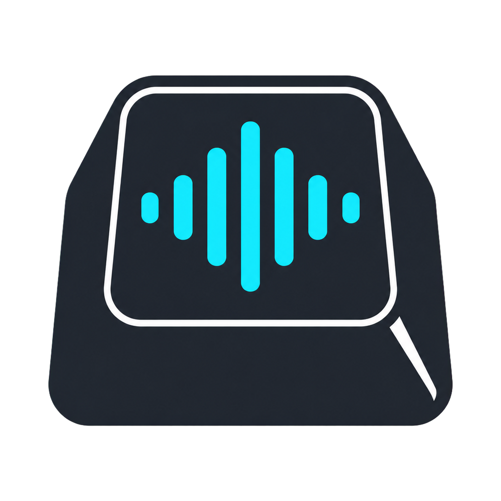

# VoxKey

<p align="center">
  
</p>

**Private, local voice typing for Windows.** Hold your selected hotkey, speak naturally, release, and VoxKey pastes polished English text back into the app you were using.

VoxKey stays out of sight while idle. A small animated orb appears only while
the hotkey is held; it disappears immediately on release while transcription,
polishing, and paste continue locally in the background.

## Local-first by design

- English-only speech recognition using local `small.en` by default, with a local `distil-large-v3` option for this PC (never `base.en`).
- Fast rule-based formatting that never changes recognized words: filler removal, capitalization, final punctuation, and preferred vocabulary casing. Spoken “new line,” “new paragraph,” “bullet point,” “question mark,” “exclamation point,” and “full stop” format directly.
- Personal memory stores phrase corrections, the last 50 successful dictations, snippets, and app-specific formatting styles on this PC. Enable **Learn from edits** in Settings to learn from a brief edit to VoxKey's own paste. Open **Personal memory** from the tray to review suggestions or delete rules.
- A snippet cue spoken by itself pastes its saved text. Minimal and bullet-note app styles also format locally. Explicit single-word backtracks such as “two, actually three” keep the correction.
- No account, subscription, API key, cloud transcription, or failure-time raw-text fallback.
- Speech failure means no paste.

## Requirements

- Windows 10/11 x64
- NVIDIA GPU is optional; VoxKey uses it when the local runtime is available and otherwise uses the selected speech model on CPU.
- Internet access and several gigabytes of free disk space are required during first-run setup. Dictation works offline after setup.

## Install and use

1. Download the latest `VoxKey-Setup-*.exe` from Releases.
2. Install for the current Windows user.
3. Start VoxKey and keep it open while it downloads and verifies its private speech model and GPU speech runtime.
4. Wait for `Ready`, click into any ordinary app, hold **Right Ctrl**, **F8**, or **F9**, speak, then release it.

The tray menu opens settings, selects the microphone, toggles sounds, repairs
models, changes the hold hotkey, edits custom vocabulary and personal memory, enables Windows autostart, opens diagnostics,
and quits VoxKey. No separate Ollama installation or command is required.

> Releases may be unsigned until a trusted signing configuration is available. Unsigned Windows builds can be blocked by Smart App Control or SmartScreen; always verify the release checksum and read the release security notice.

## Limitations

- Windows secure-desktop screens (lock screen, UAC prompts, Ctrl+Alt+Del) cannot accept dictation.
- Windows may block input into an elevated application when VoxKey is not elevated. Run VoxKey as administrator only when you specifically need to dictate into an administrator-run app.
- A custom vocabulary can improve names and preferred casing, but it cannot guarantee that the speech model hears a similar sounding word correctly.
- Automatic learning is opt-in. It checks the focused field for two minutes after a successful paste; some apps do not expose editable text to Windows UI Automation. Distinctive names and terms already in your vocabulary apply across apps. Close ordinary spelling edits apply in the app where you made them. Broad rewrites and conflicting changes wait for approval in **Personal memory**.

To test: turn on **Learn from edits** in Settings, dictate “Open git hub” into a document, then change “git hub” to “GitHub” in that document within two minutes. Open **Personal memory → Corrections** to see the learned rule, then dictate the same phrase again. Close single-word spelling edits such as “cash” to “cache” also learn in that app without a second edit.

## Diagnostics and privacy

Settings and diagnostics are stored in `%LOCALAPPDATA%\VoxKey`. The latest diagnostic capture is `%LOCALAPPDATA%\VoxKey\last-dictation.wav`; delete it whenever you want. See [privacy details](docs/privacy.md).

## Build from source

```powershell
py -3.12 -m venv .venv
.\.venv\Scripts\python.exe -m pip install -r requirements.txt
.\.venv\Scripts\python.exe -m unittest discover -s tests -v
.\.venv\Scripts\pyinstaller.exe --clean --noconfirm VoxKey.spec
& 'C:\Program Files (x86)\Inno Setup 6\ISCC.exe' installer\VoxKey.iss
```

See [architecture](docs/architecture.md), [Windows smoke testing](docs/windows-v0.1.0-smoke-test.md), [contributing](CONTRIBUTING.md), and [security](SECURITY.md).

## Local accuracy check

To collect known-text clips on your PC, run `.\.venv\Scripts\python.exe -m benchmark.record_prompts` from the repository and read each displayed sentence exactly. The clips and reference manifest are saved under ignored `benchmark/local_samples/personal/`. Compare with the same model settings used by VoxKey:

```powershell
.\.venv\Scripts\python.exe -m benchmark.run_benchmark --model small.en --manifest benchmark\local_samples\personal\manifest.json
.\.venv\Scripts\python.exe -m benchmark.run_benchmark --model distil-large-v3 --manifest benchmark\local_samples\personal\manifest.json --with-writer  # adds formatted text to each result
```

If you already have Wispr Flow output for the same spoken clips, add a `flow` string to each manifest entry. The benchmark then reports its word error rate beside VoxKey's. VoxKey does not send these recordings to Flow.
